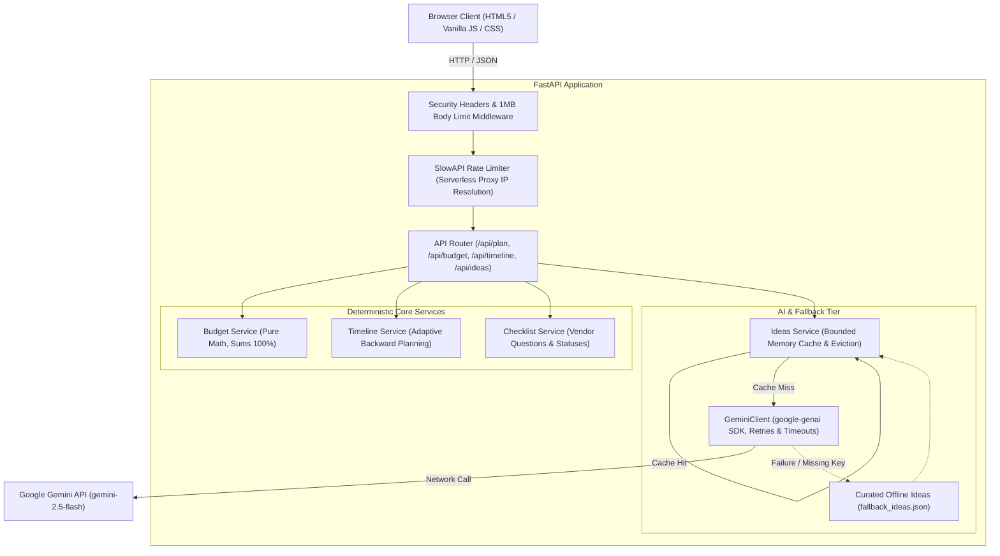

# EventEase - Celebration & Event Planning Prototype

[](https://github.com/Suhani-Tyagi/EventEase/actions/workflows/ci.yml)
[](https://www.python.org/downloads/)
[]()
[](https://github.com/astral-sh/ruff)
[](http://mypy-lang.org/)
[](docs/ACCESSIBILITY.md)

> "An event planning prototype combining deterministic financial and backward-planned timeline algorithms with curated creative ideas and offline resilience."

---

## Table of Contents
1. [Overview & Solution](#1-overview--solution)
2. [Core Deliverables & Features](#2-core-deliverables--features)
3. [Architecture Overview](#3-architecture-overview)
4. [Quickstart & Installation](#4-quickstart--installation)
   - [Running Locally with Gemini API Key](#running-locally-with-gemini-api-key)
   - [Running Completely Offline (Fallback Mode)](#running-completely-offline-fallback-mode)
   - [Deploying to Vercel](#deploying-to-vercel)
   - [Running via Docker](#running-via-docker)
5. [Environment Variables](#5-environment-variables)
6. [API Reference & OpenAPI Docs](#6-api-reference--openapi-docs)
7. [Testing & Quality Verification](#7-testing--quality-verification)
8. [Design Decisions & Trade-Offs](#8-design-decisions--trade-offs)
9. [Security & Threat Model](#9-security--threat-model)
10. [Accessibility (WCAG 2.1 AA)](#10-accessibility-wcag-21-aa)

---

## 1. Overview & Solution
Planning a milestone celebration—whether an intimate wedding, a birthday party, or a neighborhood festival—requires balancing realistic financial allocations, backward-planned timelines, and vendor contract vetting.

**EventEase** isolates mathematics and scheduling from creative ideation:
- **Deterministic, pure mathematical algorithms** calculate budget breakdowns and backward-planned milestone schedules (zero hallucinations, 100% explainable derivations).
- **Curated GenAI inspiration (Gemini 2.5 Flash)** recommends tailored aesthetic themes, signature menus, and cost-saving tips.
- **Graceful offline resilience**, ensuring the entire planning prototype operates cleanly even without an internet connection or Gemini API key.

---

## 2. Core Deliverables & Features

### 1. Multi-Step Event Intake
- Captures event type (`wedding`, `birthday`, `community`), date, headcount (1 to 10,000), total budget, currency, city, aesthetic theme, cultural/dietary traditions, and special notes.
- Divided into 3 focused stages with progress tracking and real-time inline validation.
- 3 One-Click Demonstration Scenarios (Napa Vineyard Wedding, 30th Rooftop Glow Party, Eco-Arts Community Festival).

### 2. Live Editable Budget Planner with Real-Time Balance Validation
- Interactive category breakdown with an 8.0% dedicated Contingency Buffer.
- Users can edit any category percentage or currency amount; the engine immediately updates category totals, validates whether allocations stay balanced, recalculates the per-guest cost, and updates the visual segmented bar.
- One-click "Reset Allocation" restores the benchmark distribution.

### 3. Adaptive Milestone Timeline Generator
- Backward-planned milestone schedule derived from the scheduled celebration date down to Event Day.
- **Adaptive Compression Algorithm**: Automatically scales intervals when planning horizons are compressed (<90 days, <30 days, or express blitz), guaranteeing feasible deadlines.
- Interactive completion checkboxes update progress and trigger celebration milestones.

### 4. Categorized Vendor Checklist with Filters, Notes & Contacts
- Tailored screening questions to ask prospective venues, caterers, photographers, and entertainers before signing contracts.
- Interactive status dropdowns (`to-do`, `contacted`, `booked`) with live counters.
- Filter pills (`All`, `To-Do`, `Contacted`, `Booked`) to focus on active vendor workflows.
- Local contact inputs and private notes fields auto-saved to browser storage.

### 5. Compact Celebration Progress Dashboard
- 4 real-time progress cards:
  1. **Budget Balance**: Balance status, total allocated percentage, and contingency buffer.
  2. **Milestones Done**: Completed milestones count, completion percentage, and progress bar.
  3. **Vendors Booked**: Booked vs in-progress counts and booking progress bar.
  4. **Event Countdown**: Days remaining and next upcoming deadline reminder.

### 6. LocalStorage Persistence & Plan Library
- **Active Plan Persistence**: The current celebration plan, customized budget allocations, completed milestones, vendor statuses, contacts, notes, and vendor quotes are automatically saved to `localStorage`.
- **Multi-Plan Library**: Users can name, save, reopen, duplicate, and remove multiple celebration plans locally.
  - Features confirmation modals for safe deletion and "Clear All Plans".
  - Gracefully handles browser storage quotas (`QuotaExceededError`) with user alerts.
- **Privacy Disclosure**: All plans, notes, and quotes are stored unencrypted in the local browser on that device only. They are not stored on any remote server and are readable by scripts executing on the same origin.
- A modal-guarded "Start New Plan" flow resets saved state safely without accidental data loss.

### 7. Vendor Quote Comparison View
- Side-by-side comparison of user-entered vendor quotes (base price, additional fees, total estimated cost, included services, payment terms, and status).
- **Truthful Labeling**: All quote amounts are strictly labeled as **user-provided records** and are never presented as market benchmarks, automated estimates, or algorithmic pricing.
- Interactive category filtering pills and one-click preferred quote selection.

### 8. Multi-Format Exports with Security & Standards Compliance
- **Copy Summary**: Generates a clean text summary calculating contingency from actual allocations (fixing any undefined field issues).
- **JSON Export**: Downloads the complete state as an indented JSON file.
- **CSV Spreadsheet (Formula Injection Defense)**: Formats event details, budget allocations, milestones, vendor checklists, and quote comparisons into an RFC 4180 compliant CSV file. All cells starting with formula-triggering characters (`=`, `+`, `-`, `@`, `\t`, `\r`, `|`, `%`) are safely prefixed with a single quote (`'`) to ensure spreadsheet applications open them strictly as literal text.
- **.ICS Calendar Export (RFC 5545 Compliant)**: Exports all milestone deadlines and celebration day into standard RFC 5545 iCalendar format. Escapes special characters (`,`, `;`, `\`, line breaks), strictly folds lines at $\le$ 75 octets via `\r\n `, sets exclusive all-day event end dates (`DTEND = DTSTART + 1 day`), and generates stable, unique UIDs (`@eventease.app`).
- **Export Privacy Notice**: Highlights to users when downloaded exports contain private vendor notes, contact details, or quotes.
- **Print / PDF View**: Formatted with a clean print stylesheet (`@media print`) that removes web navigation for physical printing or PDF generation.

### 9. Accessible UI & Mascot Companions
- **Lumi Companion Widget**: Floating celebration assistant that never obscures content or controls; includes a collapse/minimize toggle.
- **Reduced Motion**: Full support for `prefers-reduced-motion: reduce` in CSS, and confetti particle generation is suppressed in JavaScript.
- **WAI-ARIA Tabs**: Creative ideas tabs support full keyboard navigation (`ArrowLeft`, `ArrowRight`, `Home`, `End`).

---

## 3. Architecture Overview

### Mermaid Architectural Diagram



---

## 4. Quickstart & Installation

### Prerequisites
- Python 3.11+
- Git

### Local Setup
```bash
# 1. Clone repository
git clone https://github.com/Suhani-Tyagi/EventEase.git
cd EventEase

# 2. Create and activate virtual environment
python -m venv venv
# On Windows:
.\venv\Scripts\activate
# On Linux/macOS:
source venv/bin/activate

# 3. Install dependencies
pip install -r requirements.txt
```

### Running Locally with Gemini API Key
To enable live GenAI suggestions:
```bash
# Copy example configuration
cp .env.example .env

# Edit .env and supply your Gemini API key:
# GEMINI_API_KEY=your_actual_gemini_api_key_here

# Launch server
uvicorn app.main:create_app --factory --host 127.0.0.1 --port 8000 --reload
```
Open your browser at `http://127.0.0.1:8000`.

### Running Completely Offline (Fallback Mode)
If `GEMINI_API_KEY` is not set or left empty in `.env`:
```bash
uvicorn app.main:create_app --factory --host 127.0.0.1 --port 8000
```
The application will operate in **curated offline mode**, serving template-based ideas with an "Offline Fallback (Curated)" status badge.

### Deploying to Vercel
EventEase is configured for zero-friction serverless deployment on **Vercel** via [`vercel.json`](vercel.json) and [`api/index.py`](api/index.py):

1. **Push to GitHub**: Connect your repository (`https://github.com/Suhani-Tyagi/EventEase.git`) to Vercel.
2. **Environment Variables**:
   - `GEMINI_API_KEY` (Optional: if omitted, EventEase runs in offline fallback mode).
   - `APP_ENV`: `production`
3. **Deploy**:
   - Vercel automatically detects the Python runtime from `requirements.txt` and routes HTTP requests to `api/index.py`.
   - In the event of an unhandled exception or startup issue, `api/index.py` logs privately and returns a generic 500 error response without exposing stack traces.

### Running via Docker
```bash
# Build Docker image
docker build -t eventease:latest .

# Run container
docker run -p 8000:8000 -e GEMINI_API_KEY=your_api_key eventease:latest
```

---

## 5. Environment Variables

| Variable | Type | Default | Description |
| :--- | :--- | :--- | :--- |
| `GEMINI_API_KEY` | `string` | `None` | Google Gemini API key. If absent, offline fallback is used. |
| `APP_ENV` | `string` | `development` | Runtime environment (`development`, `production`, `test`). |
| `HOST` | `string` | `127.0.0.1` | Server host address. |
| `PORT` | `int` | `8000` | Server listening port. |
| `CORS_ALLOWED_ORIGINS` | `string` | `http://localhost:8000,http://127.0.0.1:8000` | Comma-separated CORS origin allowlist. |
| `RATE_LIMIT_PER_MINUTE` | `int` | `20` | Max requests per IP per minute on AI endpoints. |
| `REDIS_URL` | `string` | `None` | Optional Redis connection URI (e.g. `redis://localhost:6379`) for shared rate limiting across serverless instances. If omitted or unreachable, falls back to in-memory tracking. |
| `TRUSTED_PROXIES` | `string` | `127.0.0.1,::1` | Comma-separated trusted reverse proxy IP addresses or CIDR ranges. Forwarded IP headers (`X-Forwarded-For`, `X-Real-IP`) are only parsed if request peer host matches. |
| `TRUST_ALL_PROXIES` | `bool` | `False` | When True, trusts forwarded headers from any peer IP (useful for local development or testing). Defaults to False. |
| `MAX_REQUEST_BODY_BYTES` | `int` | `1048576` | Max allowable request body size (1 MB default). |
| `GEMINI_MODEL` | `string` | `gemini-2.5-flash` | Gemini model variant. |
| `LLM_TIMEOUT_SECONDS` | `float` | `10.0` | Timeout threshold for LLM generation before falling back. |
| `LLM_MAX_RETRIES` | `int` | `2` | Number of retry attempts on transient model errors. |
| `CACHE_TTL_SECONDS` | `int` | `3600` | TTL in seconds for the in-memory ideas cache. |

---

## 6. API Reference & OpenAPI Docs

The interactive OpenAPI documentation is available at `http://127.0.0.1:8000/docs`.

### Core Endpoints
- `GET /api/health`: Health status reporting service health, rate limits, and AI mode (`live` vs `offline_fallback`).
- `GET /api/presets`: Pre-configured demo scenarios (wedding, birthday, community).
- `POST /api/budget`: Pure mathematical budget allocation breakdown.
- `POST /api/timeline`: Adaptive milestone schedule backward-planned from event date.
- `GET /api/checklist/{event_type}`: Categorized screening questions for vendors.
- `POST /api/ideas`: Tailored themes, decor, menus, and cost-saving tips.
- `POST /api/plan`: Unified endpoint returning all 4 deliverables simultaneously.

---

## 7. Testing & Quality Verification

EventEase enforces strict linting, strict static typing, and automated testing across both backend and frontend layers.

### Running Quality Checks
```bash
# 1. Run Ruff Linter
ruff check app tests

# 2. Run MyPy Strict Type Checker
mypy app tests

# 3. Run Pytest Suite with Coverage Enforcement
pytest

# 4. Run Browser-Level DOM Integration Tests
npm run test:browser
```

### Verified Test Results
- **Backend Tests**: 83 tests passing with **94.77% statement coverage** across `app` under Python 3.11:
  - `app/api/routes.py`: 94%
  - `app/core/config.py`: 100%
  - `app/core/security.py`: 97%
  - `app/main.py`: 91%
  - `app/schemas.py`: 100%
  - `app/services/budget.py`: 91%
  - `app/services/checklist.py`: 88%
  - `app/services/ideas.py`: 93%
  - `app/services/llm_client.py`: 95%
  - `app/services/timeline.py`: 94%
- **Frontend DOM Integration Tests**: 87 tests passing (0 failures), covering form intake, preset loading, editable budget balancing, milestone completion, vendor status filtering, notes and contacts persistence, plan library management (naming, duplicating, deleting, QuotaExceededError handling), vendor quote comparison, CSV formula injection sanitization, RFC 5545 .ICS export compliance, and accessible WAI-ARIA tab navigation.

---

## 8. Design Decisions & Trade-Offs

1. **Separation of Deterministic Logic vs. AI Generation**:
   - Financial allocation and milestone timelines are computed through pure Python functions without LLM involvement.
   - Budgets and legal countdowns require 100% accuracy, reproducibility, and explainability. LLMs are reserved strictly for creative recommendations (decor, themes, catering concepts).
2. **Vanilla Frontend with ES Modules (Zero Build Step)**:
   - Plain semantic HTML5, a single stylesheet, and standard ES module JS without heavy frameworks.
   - Guarantees instant startup, eliminates NPM vulnerability rot, and ensures broad compatibility.
3. **Bounded In-Memory Caching & Purging**:
   - A normalized SHA256 key caches identical idea requests in memory with automatic expiration purging and capacity-based eviction (`max_cache_entries = 256`).
   - Reduces redundant Gemini API invocations, cuts latency to <5ms on cache hits, and prevents unbounded memory growth.
4. **Resilient Dual-Tier Architecture**:
   - Curated offline fallback templates activate immediately on missing API keys or request timeouts.
   - A planning assistant must remain dependable under poor connectivity or external API outages.
5. **Truthful Data Transparency**:
   - Vendor quote amounts are strictly marked as user-entered records; no synthetic benchmarks or artificial market estimates are manufactured.
   - AI status accurately indicates whether live Gemini responses or offline fallback templates are active.

---

## 9. Security & Threat Model
For comprehensive details, review [`SECURITY.md`](SECURITY.md). Key verified defenses include:
- **Prompt-Injection Defense**: Delimiter isolation (`<<<EVENT_INTAKE_DATA_START>>>`), control-character stripping, and Unicode NFKC normalization.
- **Serverless Error Sanitization**: Public serverless error sanitization (`api/index.py`) catches unhandled exceptions, logging tracebacks privately and returning generic 500 responses without leaking internals.
- **Reverse Proxy Header Trust**: Client IP resolution only trusts `X-Forwarded-For` and `X-Real-IP` when requests originate from verified upstream proxies configured via `TRUSTED_PROXIES`.
- **Serverless Rate Limiting Transparency**: Supports a centralized Redis store via `REDIS_URL`. In environments without a shared store, rate limiting operates on in-memory counters per serverless container instance rather than enforcing global IP-wide limits across concurrent containers.
- **CSV Formula Injection Defense**: Sanitizes all exported CSV cells starting with `=, +, -, @, \t, \r, |, %` by prefixing a single quote (`'`), ensuring spreadsheet software renders them strictly as literal text.
- **RFC 5545 iCalendar Compliance**: Escapes special characters, uses exclusive all-day event end dates (`DTEND = DTSTART + 1 day`), and folds lines exceeding 75 octets via `\r\n `.
- **Local Storage Transparency**: All saved plans, vendor notes, contacts, and quote records are stored unencrypted in browser `localStorage` solely on the user's local device. They are accessible to any script running on the same origin and are never synced to a remote database.
- **Export Privacy Notice**: Prominently warns users before downloading files containing private vendor notes, contact numbers, or quotes.
- **Strict Content Security Policy & Headers**: `script-src 'self'`, `frame-ancestors 'none'`, `X-Content-Type-Options: nosniff`, and non-root Docker execution (`appuser:10001`).

---

## 10. Accessibility (WCAG 2.1 AA)
For verification results and criteria breakdown, see [`docs/ACCESSIBILITY.md`](docs/ACCESSIBILITY.md).
- Landmarks: `<header role="banner">`, `<main role="main">`, `<footer role="contentinfo">`.
- Visible focus outlines (`:focus-visible`) and skip-to-content bypass link.
- High-contrast color palette (Warm Fog, Berry Good, Usu Koubai Blossom, Meadow Mauve, Soldier Green) verified >= 4.5:1 across Light and Dark themes.
- Form controls paired with visible `<label>`, `aria-describedby` hints, and `aria-live` error alerts.
- Fully accessible WAI-ARIA tab navigation supporting `ArrowLeft`, `ArrowRight`, `Home`, and `End` keys.
- Complete support for `prefers-reduced-motion` in CSS and JavaScript confetti suppression.
