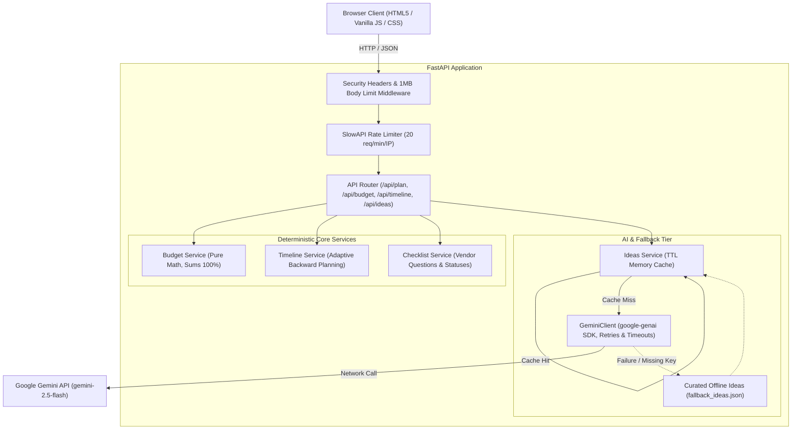

# EventEase - GenAI-Powered Celebration & Event Planning Assistant

[](https://github.com/example/eventease/actions/workflows/ci.yml)
[](https://www.python.org/downloads/)
[]()
[](https://github.com/astral-sh/ruff)
[](http://mypy-lang.org/)
[](docs/ACCESSIBILITY.md)

> "A GenAI-powered planning assistant that helps users organize weddings, birthdays, and community events with budgets, timelines, vendor checklists, and personalized ideas."

---

## Table of Contents
1. [Overview & Solution](#overview--solution)
2. [Core Deliverables & Features](#core-deliverables--features)
3. [Architecture Overview](#architecture-overview)
4. [Quickstart & Installation](#quickstart--installation)
   - [Running with Gemini API Key](#running-with-gemini-api-key)
   - [Running Completely Offline (Fallback Mode)](#running-completely-offline-fallback-mode)
   - [Running via Docker](#running-via-docker)
5. [Environment Variables](#environment-variables)
6. [API Reference & OpenAPI Docs](#api-reference--openapi-docs)
7. [Testing & Quality Verification](#testing--quality-verification)
8. [Design Decisions & Trade-Offs](#design-decisions--trade-offs)
9. [Security & Threat Model](#security--threat-model)
10. [Accessibility (WCAG 2.1 AA)](#accessibility-wcag-21-aa)
11. [Limitations & Future Roadmap](#limitations--future-roadmap)

---

## 1. Overview & Solution
Planning a major milestone celebration—whether an intimate wedding, a milestone birthday, or a 500-attendee neighborhood festival—requires balancing complex financial allocations, strict backward-planned timelines, and vendor contract vetting. Traditional solutions either present opaque black-box estimates or overwhelm users with static spreadsheets.

**EventEase** solves this by pairing:
- **Deterministic, pure mathematical engines** for budget allocation and timeline milestones (zero AI hallucinations, 100% explainable derivations).
- **Curated GenAI inspiration (Gemini 2.5 Flash)** for tailored themes, menus, and cost-saving tips.
- **Graceful offline resilience**, ensuring the full planning suite operates seamlessly even when disconnected from cloud APIs.

---

## 2. Core Deliverables & Features

### 1. Multi-Step Event Intake
- Captures event type (`wedding`, `birthday`, `community`), date, headcount (1 to 10,000), total budget, currency, city, aesthetic theme, cultural/dietary traditions, and special notes.
- Divided into 3 focused stages with progress tracking and real-time inline validation.
- 3 One-Click Demonstration Scenarios (Napa Vineyard Wedding, 30th Rooftop Glow Party, Eco-Arts Community Festival).

### 2. Deterministic Budget Planner
- Category breakdowns: Venue, Catering, Decor, Entertainment, Photography, Attire, Misc, and a dedicated **8.0% Contingency Reserve** (within the 5-10% standard).
- Type-specific baseline templates guaranteeing allocations sum strictly to 100.0%.
- Calculates per-guest metrics and automatically issues an explicit advisory warning if the budget falls below realistic industry thresholds.

### 3. Adaptive Milestone Timeline Generator
- Backward-planned milestone schedule derived from the scheduled event date down to Event Day.
- **Adaptive Compression Algorithm**: Automatically scales intervals when planning horizons are compressed (<90 days, <30 days, or <7 days express blitz), guaranteeing feasible deadlines.

### 4. Categorized Vendor Checklist
- Tailored supplier questions to ask prospective venues, caterers, photographers, entertainers, and safety authorities before signing contracts.
- Interactive status toggles (`to-do`, `contacted`, `booked`) with dynamic booking counters.

### 5. Personalized GenAI Inspiration
- Tailored themes, decor concepts, menus, activities, and actionable budget-saving tips generated via the official `google-genai` SDK with strict JSON schema validation.

### 6. Graceful Offline Fallback
- If the Gemini API key is omitted, or if network timeouts or API errors occur, EventEase automatically falls back to curated template-based ideas with a clear status notice. The app never crashes or hangs.

### 7. Dual Export Capability
- **JSON Export**: Downloads the complete state as an indented JSON file.
- **Printable / PDF View**: Formatted with a clean print stylesheet (`@media print`) that removes web navigation and formats the plan for physical printing or PDF saving.

---

## 3. Architecture Overview

### Mermaid Architectural Diagram



### Directory Structure
```text
eventease/
├── app/
│   ├── api/
│   │   ├── __init__.py
│   │   └── routes.py           # REST endpoints & dependency injection
│   ├── core/
│   │   ├── __init__.py
│   │   ├── config.py           # Pydantic-settings configuration
│   │   └── security.py         # Prompt-injection sanitization & security middleware
│   ├── data/
│   │   ├── budget_templates.json
│   │   ├── checklist_templates.json
│   │   ├── fallback_ideas.json
│   │   └── timeline_templates.json
│   ├── services/
│   │   ├── __init__.py
│   │   ├── budget.py           # Pure budget allocation
│   │   ├── checklist.py        # Vendor checklist service
│   │   ├── ideas.py            # Ideas orchestrator, caching & fallback
│   │   ├── llm_client.py       # LLM Protocol, google-genai & Mock client
│   │   └── timeline.py         # Adaptive milestone generator
│   ├── main.py                 # Application factory & exception handlers
│   └── schemas.py              # Pydantic v2 strict models
├── docs/
│   └── ACCESSIBILITY.md        # WCAG 2.1 AA audit & report
├── static/
│   ├── css/
│   │   └── style.css           # Single CSS file with dark mode & print styles
│   └── js/
│       └── app.js              # Vanilla ES module frontend
├── templates/
│   └── index.html              # Semantic HTML5 template with ARIA landmarks
├── tests/
│   ├── conftest.py             # Test fixtures & mocked LLM clients
│   ├── test_api.py             # Integration & HTTP status tests
│   ├── test_budget.py          # Budget unit tests (sum 100%, edge cases)
│   ├── test_checklist.py       # Checklist & status override tests
│   ├── test_ideas.py           # Caching & prompt delimiter tests
│   ├── test_llm_client.py      # LLM error, retry, and fallback tests
│   ├── test_schemas.py         # Pydantic validation & boundary tests
│   ├── test_security.py        # Injection sanitization & security header tests
│   └── test_timeline.py        # Timeline compression tests
├── .env.example
├── .gitignore
├── Dockerfile                  # Non-root container specification
├── Makefile                    # Standard make targets (run, test, lint, format)
├── pyproject.toml              # Tool configuration (Ruff, MyPy, PyTest)
├── requirements.txt            # Pinned dependencies
├── SECURITY.md                 # Threat model & mitigation strategies
└── README.md
```

---

## 4. Quickstart & Installation

### Prerequisites
- Python 3.11+
- Git

### Local Setup
```bash
# 1. Clone repository
git clone https://github.com/example/eventease.git
cd eventease

# 2. Create and activate virtual environment
python -m venv venv
# On Windows:
.\venv\Scripts\activate
# On Linux/macOS:
source venv/bin/activate

# 3. Install pinned dependencies
pip install -r requirements.txt
```

### Running with Gemini API Key
To enable live GenAI suggestions:
```bash
# Copy example configuration
cp .env.example .env

# Edit .env and supply your Gemini API key:
# GEMINI_API_KEY=your_actual_gemini_api_key_here

# Launch server
uvicorn app.main:create_app --factory --host 127.0.0.1 --port 8000 --reload
```
Open your browser at `http://127.0.0.1:8000`.

### Running Completely Offline (Fallback Mode)
If `GEMINI_API_KEY` is not set or left empty in `.env`:
```bash
uvicorn app.main:create_app --factory --host 127.0.0.1 --port 8000
```
The application will operate in **curated offline mode**, serving template-based ideas with a clear badge indicating offline operation.

### Running via Docker
The provided Dockerfile builds a secure image running as non-root user `appuser`:
```bash
# Build Docker image
docker build -t eventease:latest .

# Run container
docker run -p 8000:8000 -e GEMINI_API_KEY=your_api_key eventease:latest
```

### Deploying to Vercel
EventEase is pre-configured for zero-friction serverless deployment on **Vercel** via [`vercel.json`](vercel.json) and [`api/index.py`](api/index.py):

1. **Push to GitHub**: Connect your GitHub repository (`https://github.com/Suhani-Tyagi/EventEase.git`) to Vercel.
2. **Configure Environment Variables in Vercel Project Settings**:
   - `GEMINI_API_KEY` (Optional: if omitted, EventEase seamlessly runs in curated offline fallback mode).
   - `APP_ENV`: `production`
3. **Deploy**:
   - Vercel automatically detects the Python runtime from `requirements.txt` and routes all HTTP requests to `api/index.py`. Static assets under `static/` are served with high-performance edge caching.

---

## 5. Environment Variables

| Variable | Type | Default | Description |
| :--- | :--- | :--- | :--- |
| `GEMINI_API_KEY` | `string` | `None` | Google Gemini API key. If absent, offline fallback is used. |
| `APP_ENV` | `string` | `development` | Runtime environment (`development`, `production`, `test`). |
| `HOST` | `string` | `127.0.0.1` | Server host address. |
| `PORT` | `int` | `8000` | Server listening port. |
| `CORS_ALLOWED_ORIGINS` | `string` | `http://localhost:8000,http://127.0.0.1:8000` | Comma-separated CORS origin allowlist. |
| `RATE_LIMIT_PER_MINUTE` | `int` | `20` | Max requests per IP per minute on AI endpoints. |
| `MAX_REQUEST_BODY_BYTES` | `int` | `1048576` | Max allowable request body size (1 MB default). |
| `GEMINI_MODEL` | `string` | `gemini-2.5-flash` | Gemini model variant. |
| `LLM_TIMEOUT_SECONDS` | `float` | `10.0` | Timeout threshold for LLM generation before falling back. |
| `LLM_MAX_RETRIES` | `int` | `2` | Number of retry attempts on transient model errors. |
| `CACHE_TTL_SECONDS` | `int` | `3600` | TTL in seconds for the in-memory ideas cache. |

---

## 6. API Reference & OpenAPI Docs

The interactive OpenAPI documentation is available at `http://127.0.0.1:8000/docs`.

### Core Endpoints
- `GET /api/health`: Health status check.
- `GET /api/presets`: Pre-configured demo scenarios (wedding, birthday, community).
- `POST /api/budget`: Pure mathematical budget allocation breakdown.
- `POST /api/timeline`: Adaptive milestone schedule backward-planned from event date.
- `GET /api/checklist/{event_type}`: Categorized screening questions for vendors.
- `POST /api/ideas`: Tailored themes, decor, menus, and cost-saving tips.
- `POST /api/plan`: Unified endpoint returning all 4 deliverables simultaneously.

---

## 7. Testing & Quality Verification

EventEase enforces strict linting, type-checking, and a minimum **90% test coverage** threshold.

### Running Quality Checks
```bash
# 1. Run Ruff Linter
ruff check app tests

# 2. Run MyPy Strict Type Checker
mypy app tests

# 3. Run Pytest Suite with Coverage Enforcement
pytest
```

### Coverage Report
```text
Name                         Stmts   Miss  Cover   Missing
----------------------------------------------------------
app/api/routes.py               49      3    94%   32, 202-203
app/core/config.py              22      0   100%
app/core/security.py            42      0   100%
app/main.py                     59      5    92%   76-77, 123-126
app/schemas.py                  54      0   100%
app/services/budget.py          31      0   100%
app/services/checklist.py       20      0   100%
app/services/ideas.py           62      3    95%   158-160
app/services/llm_client.py      56      3    95%   68, 106, 113
app/services/timeline.py        49      0   100%
----------------------------------------------------------
TOTAL                          444     14    97%
Total Coverage: 96.85% (Passing --cov-fail-under=90)
```

---

## 8. Design Decisions & Trade-Offs

1. **Separation of Deterministic Logic vs. AI Generation**:
   - *Decision*: Financial allocation and milestone timelines are computed through pure Python functions without LLM involvement.
   - *Rationale*: Budgets and legal countdowns require 100% accuracy, reproducibility, and explainability. LLMs are reserved strictly for creative recommendations (decor, themes, catering concepts).
2. **Vanilla Frontend with ES Modules (Zero Build Step)**:
   - *Decision*: Plain semantic HTML5, a single stylesheet, and standard ES module JS without Webpack, Vite, or React.
   - *Rationale*: Guarantees instant startup, eliminates NPM vulnerability rot, and ensures compatibility across low-end mobile devices.
3. **In-Memory TTL Caching**:
   - *Decision*: A normalized SHA256 key caches identical idea requests in memory.
   - *Rationale*: Drastically reduces redundant Gemini API invocations, cuts latency to <5ms on cache hits, and saves API quotas.
4. **Resilient Dual-Tier Architecture**:
   - *Decision*: Curated offline fallback templates activate immediately on missing API keys or request timeouts.
   - *Rationale*: A planning assistant must remain dependable under poor connectivity or external API outages.

---

## 9. Security & Threat Model
For comprehensive details, review [`SECURITY.md`](SECURITY.md). Key defenses include:
- Prompt-injection defense using delimiter isolation (`<<<EVENT_INTAKE_DATA_START>>>`) and control-character stripping.
- Output encoding via `textContent` exclusively in the DOM.
- Strict Content Security Policy (`script-src 'self'`) disallowing inline scripts.
- Rate limiting per client IP (20 requests/minute).
- Non-root Docker execution (`appuser:10001`).

---

## 10. Accessibility (WCAG 2.1 AA)
For verification results and criteria breakdown, see [`docs/ACCESSIBILITY.md`](docs/ACCESSIBILITY.md).
- Landmarks: `<header role="banner">`, `<main role="main">`, `<footer role="contentinfo">`.
- Visible focus outlines (`:focus-visible`) and skip-to-content bypass link.
- Color contrast >= 4.5:1 across both Light and Dark themes.
- Form controls paired with visible `<label>`, `aria-describedby` hints, and `aria-live` error alerts.
- Respects `prefers-reduced-motion` and `prefers-color-scheme`.

---

## 11. Limitations & Future Roadmap
- **Multi-Currency Dynamic Conversion**: Current budget conversions apply nominal ISO currency codes; future releases could integrate live FX rate lookups.
- **Calendar Synchronization**: Future versions can generate `.ics` iCalendar files to synchronize backward-planned milestones directly with Google Calendar or Apple Calendar.
- **Collaborative Real-Time Planning**: Adding WebSockets and persistent database storage to allow multiple family or committee members to update vendor statuses in real-time.
